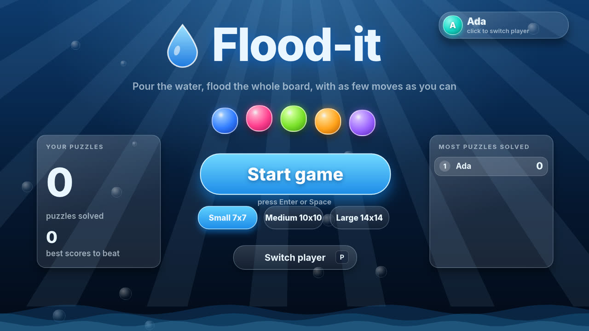
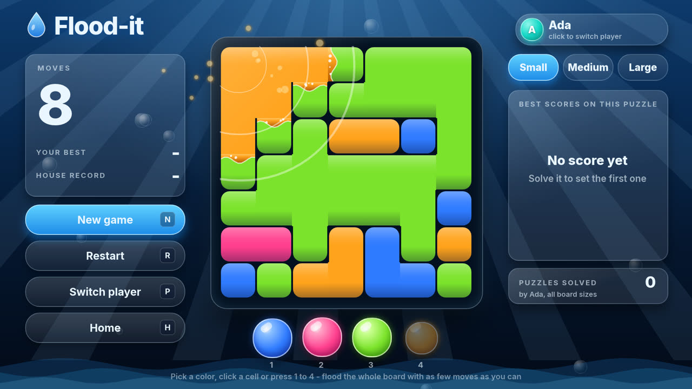
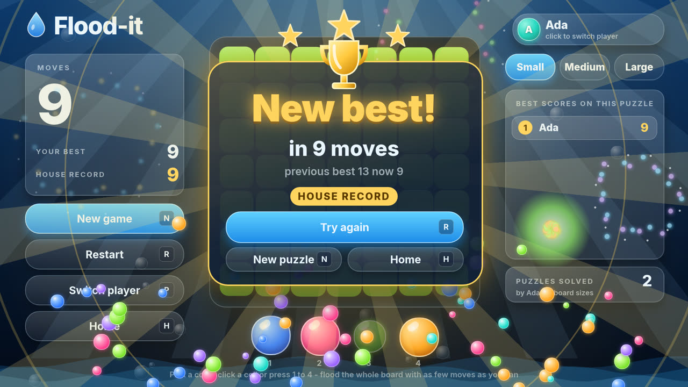
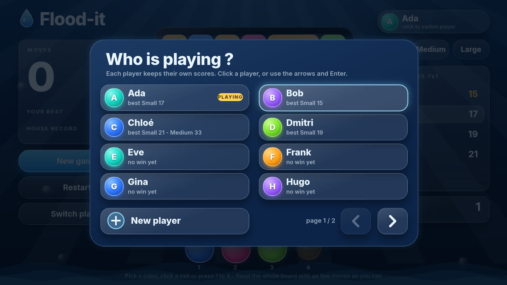
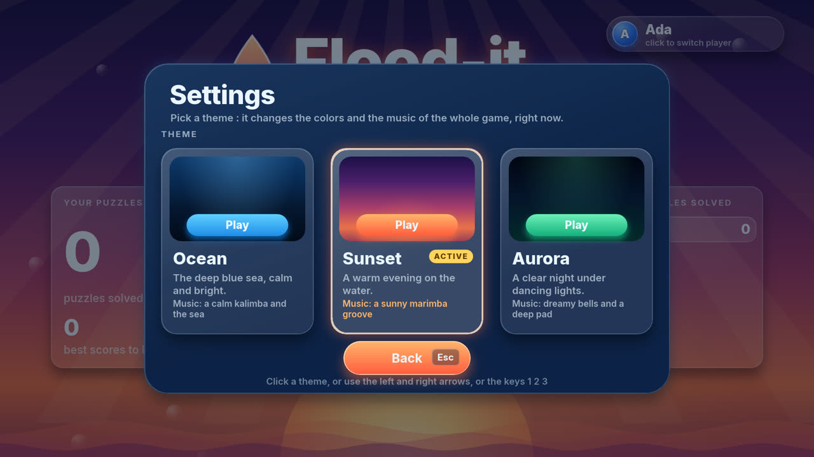
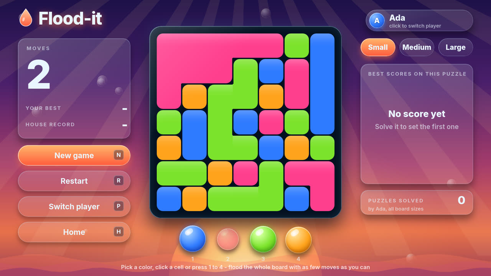

# Flood-it

[](https://github.com/Shuunen/flood-it/blob/master/LICENSE)
[](https://hits.sh/github.com/Shuunen/flood-it/)

> Flood-it, a game for liquid snakes.







Pour colored water from the top left corner and flood the whole board with as few moves as you can.

## Features

- **Flowing water** : the water runs from the cells already flooded into the next ones, like a valve opened at the top left, with a foamy front, bubbles and drops. Cells of the same color merge into one body of water
- **Music and sound** : a background music that loops, the sea breathing behind it, water poured with every move, little sounds for the interface
- **Three themes** : pick one in the settings, from the home screen. Ocean (blue, a calm kalimba), Sunset (orange, a sunny marimba groove), Aurora (green, dreamy bells over a deep pad). Each has its own accent color, scenery, music and ambience
- **Scores per puzzle** : your best score is the fewest moves you needed on a given grid. Solve it again with less moves and the board throws a party : golden rays, fireworks, a trophy and a fanfare
- **After each puzzle** : try again to beat your score, play a new puzzle, or go back home
- **A home screen** : start a game, pick the board size, switch player, open the settings
- **Players** : type a name and pick a color to create a player, rename, recolor or delete a player from the player list, switch from one player to another at any time. Switching in the middle of a puzzle gives the same grid to the next player, so players can compete on it
- **Three board sizes** : small 7x7 with 4 colors, medium 10x10 with 5 colors, large 14x14 with 6 colors



## Play

The game is made with [raea](https://raea.io), a GPU engine that runs games written in React and TypeScript. It runs on Macs with Apple Silicon and on x86_64 Linux (glibc 2.39 or newer, a processor with AVX, ALSA and fontconfig). On Windows, install raea from PowerShell then run `raea play src/edit.tsx`.

On a Mac or on Linux, download or clone the game, open a terminal in its folder and run :

```sh
./play.sh
```

The script checks that raea is installed, offers to install it when it is not (a few hundred MB, in `~/.raea`), then starts the game. If the file is not executable, run `sh play.sh` instead. `./play.sh --check` only checks that everything is ready, `./play.sh --yes` installs without asking.

With [pnpm](https://pnpm.io) and raea already there, `pnpm play` does the same.

| Key             | Does                                  |
| --------------- | ------------------------------------- |
| `1` to `6`      | pour that color                       |
| click           | a cell or a water drop                |
| `N`             | new puzzle                            |
| `R`             | restart the same puzzle               |
| `P`             | switch player                         |
| `S`             | settings, from the home screen        |
| `H` or `Esc`    | back home                             |
| `Enter`/`Space` | start game, or try again once you won |
| arrows, `Enter` | pick a player in the list             |
| `←`             | erase a letter of a name              |

raea games do not receive the Backspace, Delete and Tab keys, hence the arrow.

Scores and players are stored in a small SQLite database, `~/.flood-it/flood-it.db`. Set `FLOOD_IT_DB` to keep it somewhere else.







## Develop

- `src/logic` : the rules of the board and the players, pure functions, 100% tested
- `src/game` : what a click or a key does (`state.ts`) and where things sit on the 1920x1080 stage (`layout.ts`), pure too
- `src/view` : the picture, the sea, the water, the panels, the celebrations
- `src/audio` : the music, the sea and every sound effect, written as Tone.js notes and synths, no sound file at all
- `src/platform` : the only impure part, reads and writes the scores database
- `src/edit.tsx` : puts it all together for raea

The game is a pure function of the frame : the same keys and clicks always give the same game, so a play can be rendered back to video or sound, which is how the pictures above were made :

```sh
raea render src/edit.tsx --composition flood-it-demo --input keys-and-clicks.json --at 120 -o stills
```

`pnpm check` runs the format, the lint, the types, the tests and the other checks.

## Thanks

- [Boxy Svg](https://boxy-svg.com) : simple & effective svg editor
- [Oxc](https://oxc.rs) : a lovely super-fast collection of JavaScript tools written in Rust
- [pnpm](https://pnpm.io) : fast, disk space efficient package manager
- [Github](https://github.com) : for all their great work year after year, pushing OSS forward
- [Knip](https://github.com/webpro/knip) : super tool to find & fix problems
- [Raea](https://raea.io) : the engine that makes this water, and its sound, possible
- [Repo-checker](https://github.com/Shuunen/repo-checker) : eslint cover /src code and this tool the rest ^^
- [Shields.io](https://shields.io) : for the nice badges on top of this readme
- [Svg Omg](https://jakearchibald.github.io/svgomg/) : the great king of svg file size reduction
- [V8](https://github.com/demurgos/v8-coverage) : simple & effective cli for code coverage
- [Vitest](https://github.com/vitest-dev/vitest) : super fast vite-native testing framework
